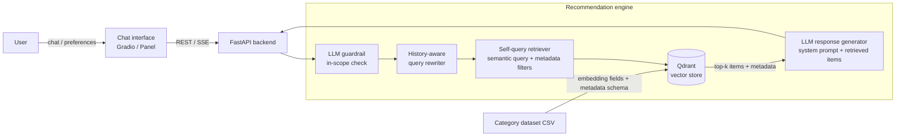

# Gen2Rec

**A generalized framework for using large language models as recommender systems.**

This was done as an Undergraduate Final Year Project at University of Sri Jayewardenepura(2024). This is the public version of the project. 

Group Members:
Chathurinda Ranasinghe
Dinuka Gayashan
Surali Pathirana

Supervisor:
Dr. Randima Dinalankara

Co-Supervisor:
Ms. Akarshani Amarasinghe

Gen2Rec turns any tabular item catalogue (movies, laptops, news articles, games, vehicles, ...) into a conversational, explainable recommender without training a domain-specific model. A user describes the category, uploads a CSV, and says which columns carry descriptive text and which carry structured attributes. Gen2Rec then builds a retrieval-augmented generation (RAG) pipeline that understands free-form requests such as *"a light laptop under $1000 for programming, with at least 16GB RAM"* and answers with ranked, justified recommendations.

## Motivation

Classical recommenders (collaborative filtering, matrix factorization, sequence models) are trained per domain, need interaction histories, cope poorly with cold-start, and cannot explain their output in natural language. LLMs bring broad world knowledge and strong language understanding, but on their own they hallucinate items and do not know a specific catalogue.

Gen2Rec explores a middle path: **ground the LLM in the catalogue through retrieval and structured filtering, and keep everything domain-specific in configuration rather than code.** The same engine serves every category it was tested on.

## Key ideas

- **Domain generalization by configuration.** The category name, dataset, embedding fields, metadata schema and system prompt are supplied at initialization time. No code changes are needed for a new domain.
- **Self-querying retrieval.** User requests are translated by the LLM into a semantic query *plus* structured metadata filters (e.g. `price < 1000 AND memory_size >= 16`) and a result limit, executed against a Qdrant vector store. This combines semantic matching with hard constraints that pure embedding search misses.
- **Conversation-aware retrieval.** A history-aware retriever rewrites follow-up messages ("cheaper ones?", "something similar but newer") into standalone queries using the chat history.
- **Explainable output.** The final LLM call receives the retrieved items and their metadata, so recommendations come with reasons tied to real catalogue entries.
- **Guardrails.** Every query is first classified by an LLM as in-scope or out-of-scope for the configured category (cross-domain requests are allowed), and off-topic requests are rejected.
- **LLM-enriched item representations.** For sparse datasets, an LLM generates natural-language descriptions of each item from its raw specifications before embedding (see `embeddings/generate_game_embeddings.py`).
- **Model flexibility, no vendor lock-in.** LLMs and embedding models are swappable at runtime: OpenAI GPT-4o / GPT-3.5-Turbo or a locally hosted Llama 3 70B via Ollama; OpenAI `text-embedding-3-large` or Voyage AI `voyage-large-2-instruct`.

## Architecture



The system has three main components:

1. **Chat interface** (`frontend/`). A generic Gradio app for configuring any category and chatting with it, plus three Panel demo storefronts (laptops, movies, news) that show recommendation cards next to a streaming chat.
2. **Prompt constructor** (`backend/prompts/`, `backend/engine.py`). Jinja2 templates parameterized by category for query rewriting and guardrails, combined with the user-supplied system prompt, chat history and user profile.
3. **Recommendation engine** (`backend/engine.py`). A LangChain pipeline: guardrail → history-aware retriever → self-query retriever over Qdrant → generation.

### Request flow

1. `POST /init` sets the category, dataset, embedding fields, metadata schema (name, type, description per attribute), embedding model and system prompt. The vector store is built (or an existing collection is loaded) in the background.
2. `POST /config` selects the LLM and optionally sets a free-text user profile used for personalized recommendations.
3. `GET /chat` / `GET /chat-stream` run a conversational turn. `GET /recommendations?number=N` returns a top-N list, personalized when a user profile is set.

## Datasets

Eight categories were prepared to test how well the framework generalizes. Some were enriched with external sources (Google Books API, OMDb API) or collected from scratch with custom scrapers. Details and download links are in [`datasets/README.md`](datasets/README.md).

| Category | Source | Items |
|---|---|---|
| Book | Amazon books + Google Books descriptions | 1,029 |
| Game | Steam video games (user play/purchase data) | 200,000 |
| House | KC house data | 21,613 |
| Laptop | Custom, collected via the Noteb API | 630 |
| Movie | MovieLens titles enriched via OMDb | 6,705 |
| News | News Category Dataset | 210,294 |
| Music | Spotify dataset | 170,653 |
| Vehicle | Custom, scraped from usedcars.com | 2,488 |

## Repository structure

```
backend/                 FastAPI service and recommendation engine
  api.py                 REST + streaming endpoints
  engine.py              RAG pipeline: guardrails, self-query retrieval, generation
  common.py              Supported LLMs and embedding models
  prompts/               Jinja2 templates for query rewriting and guardrails
frontend/
  client_interface.py    Generic Gradio UI: initialize any category, configure, chat
  demos/                 Panel storefront demos (laptop, movie, news)
datasets/
  scrapers/              Data collection (Newegg, Noteb API, usedcars.com)
  preprocessors/         Cleaning / enrichment scripts per category
embeddings/              Offline embedding generation into Qdrant collections
```

## Getting started

Requires Python 3.12.

```bash
python -m venv venv
source venv/bin/activate          # Windows: venv\Scripts\activate
pip install -r requirements.txt
cp .env.example .env              # add your OpenAI / Voyage AI keys
```

Build a vector collection for a category (prepare the CSV with the scripts in `datasets/` first, and provide a metadata schema JSON next to it):

```bash
python -m embeddings.generate_movie_embeddings
```

Start the backend and a frontend:

```bash
uvicorn backend.api:app --port 8000
python frontend/client_interface.py        # generic UI on :8001
panel serve frontend/demos/movie_demo.py   # or a domain demo
```

To use an open-source model instead of GPT-4o, run Llama 3 70B with [Ollama](https://ollama.com) and set `OSS=1`.

## Tech stack

Python · LangChain · OpenAI GPT-4o · Llama 3 (Ollama) · Voyage AI / OpenAI embeddings · Qdrant · FastAPI · Gradio · Panel · BeautifulSoup / Selenium

## Limitations and future work

- Quantitative evaluation against classical baselines (e.g. hit-rate / NDCG on held-out interactions) was planned but is not included in this codebase.
- The guardrail step always uses GPT-4o, even when the main pipeline runs on a local model.
- Engine state (configuration, chat history) is held in memory for a single session; multi-user support would need per-session state.
- Uploading a new dataset through the UI is only partly wired up. The tested path uses collections pre-built with the scripts in `embeddings/`.

## License

[MIT](LICENSE)
